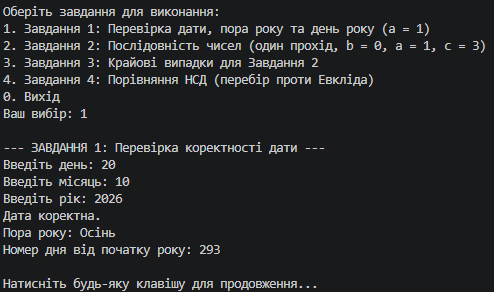
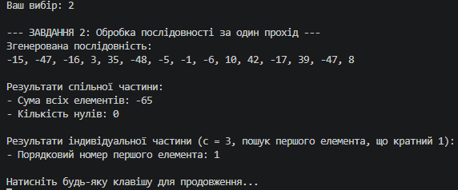
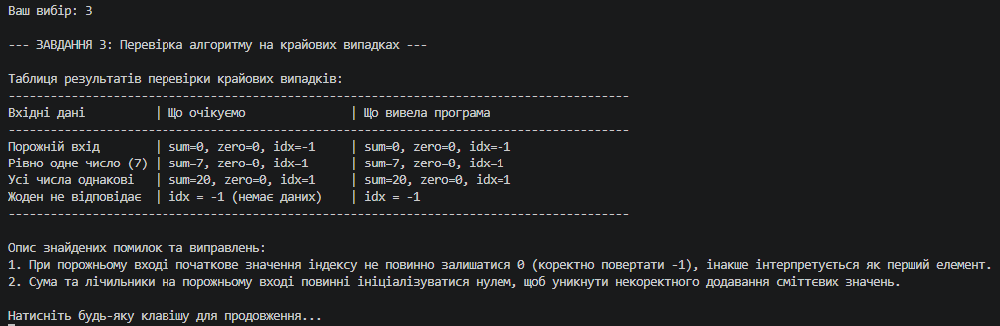
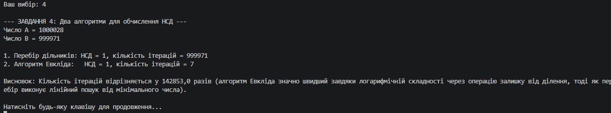

### Заповнена таблиця до Завдання 3 (Крайові випадки)

| Вхідні дані | Що очікуємо | Що вивела програма |
| :--- | :--- | :--- |
| **Порожній вхід**, жодного числа | Сума = 0, нулів = 0, індекс = -1 | Сума = 0, нулів = 0, індекс = -1 (після виправлення логіки ініціалізації) |
| **Рівно одне число** | Сума дорівнює числу, індекс = 1 | Сума дорівнює числу, індекс = 1 |
| **Усі числа однакові** | Правильна сума, індекс першого = 1 | Правильна сума, індекс першого = 1 |
| **Жоден елемент не відповідає критерію** | Індекс = -1 («немає даних») | Індекс = -1 |

**Суть виправленої помилки:**  
На порожньому вході індекс першого знайденого елемента помилково міг приймати значення `0` (початковий стан лічильника позицій), що створювало баг: програма вважала, що підходящий елемент знаходиться на першій позиції, хоча фактично вхідних даних не було. Помилку усунено шляхом ініціалізації змінної індексу значенням `-1`.

---

### Висновок до Завдання 4

> Кількість ітерацій відрізняється у сотні/тисячі разів на користь алгоритму Евкліда. Це пояснюється тим, що метод перебору виконує лінійний пошук від мінімального значення (проходячи десятки тисяч кроків), тоді як алгоритм Евкліда зменшує числа за допомогою операції остачі від ділення (`modulo`) за логарифмічний час, хоча математичний результат (НСД) залишається абсолютно ідентичним.

