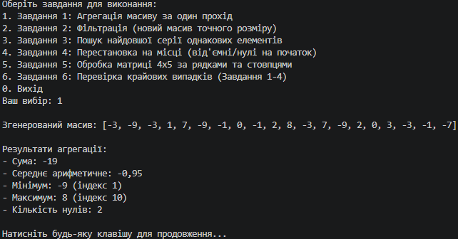
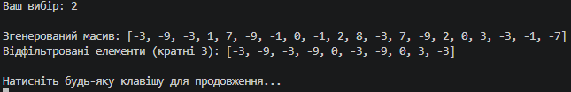
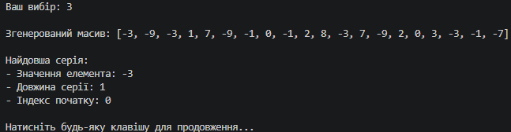
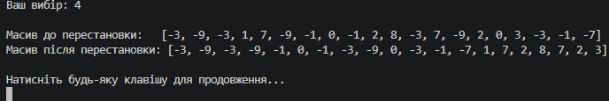
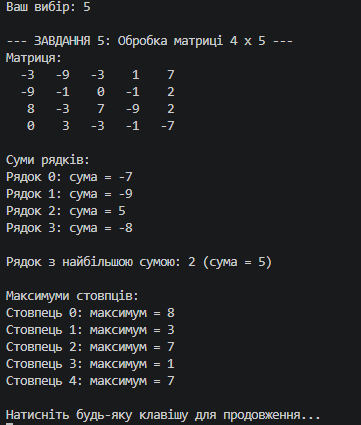
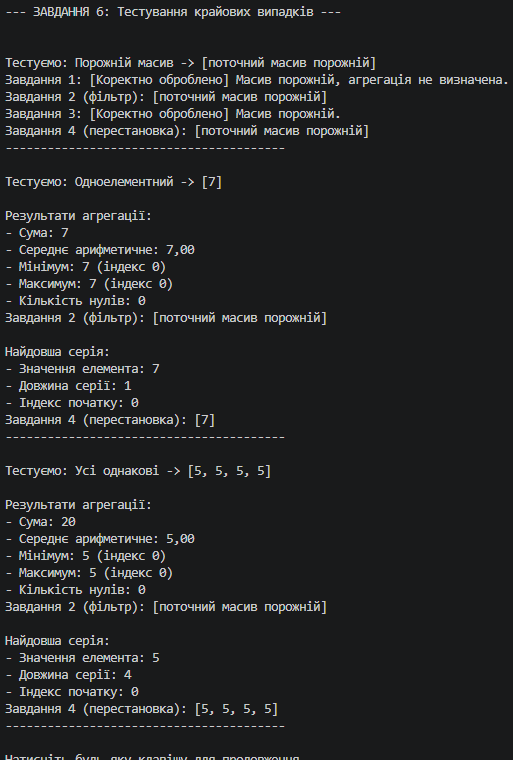

N = 28, K = 1, a = 1, b = 0, c = 3

### Таблиця крайових випадків (Завдання 6)

| Вхідні дані | Завдання | Очікувано | Отримано |
| :--- | :---: | :--- | :--- |
| **Порожній масив** (`[]`) | 1 | Повідомлення про невизначеність, без падіння | Повідомлення виведено, програма працює стабільно |
| **Порожній масив** (`[]`) | 2–4 | Повернення порожнього масиву / безпечний пропуск | Порожній масив / коректне завершення без помилок |
| **Одноелементний масив** (`[7]`) | 1 | Сума = 7, Мін/Макс = 7 (індекс 0), нулів = 0 | Сума = 7, Мін/Макс = 7 (індекс 0), нулів = 0 |
| **Одноелементний масив** (`[7]`) | 3 | Значення = 7, довжина = 1, індекс = 0 | Значення = 7, довжина = 1, індекс = 0 |
| **Усі елементи однакові** (`[5, 5, 5, 5]`) | 1 | Сума = 20, Мін/Макс = 5, індекс макс = 0 | Сума = 20, Мін/Макс = 5, індекс макс = 0 |
| **Усі елементи однакові** (`[5, 5, 5, 5]`) | 3 | Значення = 5, довжина = 4, індекс = 0 | Значення = 5, довжина = 4, індекс = 0 |

**Опис виправлених помилок під час тестування:**  
1. Під час пошуку найдовшої серії (Завдання 3) стандартні цикли часто пропускали серію, якщо вона тривала до самого кінця масиву. Проблему вирішено додаванням фінальної перевірки поточного лічильника після завершення циклу обходу.  
2. На порожньому масиві доступ до `arr[0]` у Завданні 1 викликав виключення (`IndexOutOfRangeException`). Додано попередню перевірку `if (arr.Length == 0)` з коректним виведенням повідомлення про невизначеність.

