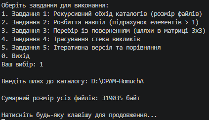
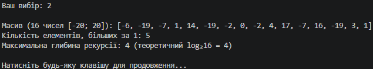
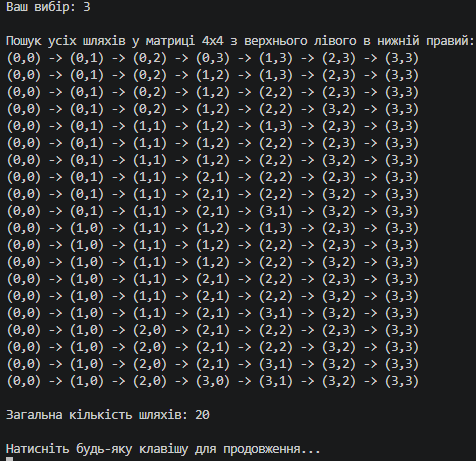
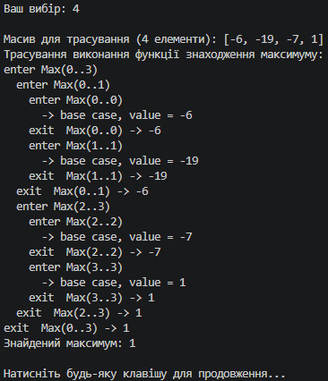
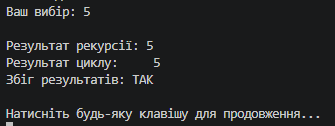

N = 28, K = 1, a = 1, b = 0, c = 3

### Базові випадки рекурсивних функцій
1. **Завдання 1 (Обхід каталогів):** Неявний базовий випадок полягає в тому, що коли папка не містить підкаталогів, цикл обходу підпапок не виконується жодного разу, а функція просто підраховує файли в поточному каталозі та завершує роботу.
2. **Завдання 2 (Розбиття навпіл):** Базовим випадком є досягнення межі `lo == hi` (один елемент масиву), коли подальший поділ неможливий і повертається значення безпосередньо з єдиного елемента.
3. **Завдання 3 (Перебір шляхів у матриці):** Базовий випадок настає тоді, коли поточні координати сягають нижнього правого кута матриці (`r == rows - 1 && c == cols - 1`), після чого сформований шлях додається до загального списку результатів.

---

### Трасування стека викликів (Завдання 4)

Вивід трасування функції пошуку максимуму для масиву з 4 елементів:
```text
enter Max(0..3)
  enter Max(0..1)
    enter Max(0..0)
      -> base case, value = 5
    exit  Max(0..0) -> 5
    enter Max(1..1)
      -> base case, value = -12
    exit  Max(1..1) -> -12
  exit  Max(0..1) -> 5
  enter Max(2..3)
    enter Max(2..2)
      -> base case, value = 8
    exit  Max(2..2) -> 8
    enter Max(3..3)
      -> base case, value = 3
    exit  Max(3..3) -> 3
  exit  Max(2..3) -> 8
exit  Max(0..3) -> 8
```




