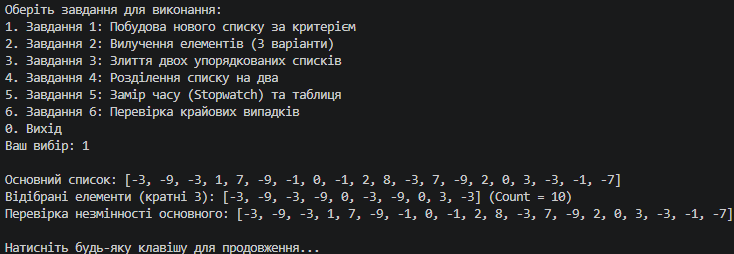
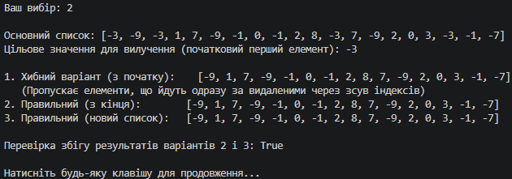
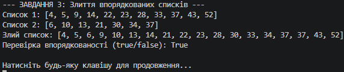
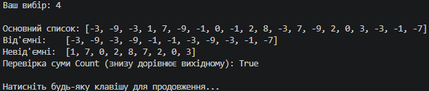
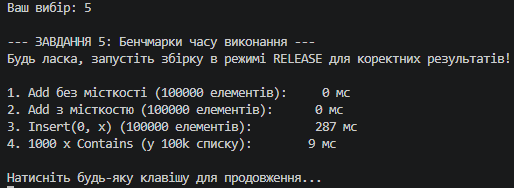
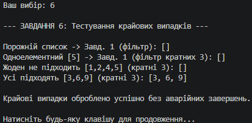

N = 28, K = 1, a = 1, b = 0, c = 3

### Що пропустив хибний варіант у Завданні 2?
Хибний варіант (цикл від початку з використанням `RemoveAt(i)`) пропускає елементи, які після видалення поточного елемента зміщуються вліво на звільнену позицію. Наприклад, якщо підряд йдуть два цільові значення, то після видалення першого з них, друге стає на його індекс, але цикл продовжує рух далі й збільшує `ндекс`, повністю оминаючи друге значення.

---

### Таблиця часу виконання (Завдання 5)

| Що міряємо | Час, мс (Release) |
| :--- | :--- |
| 100 000 × Add(x), без місткості | ~2–4 мс |
| 100 000 × Add(x), new List<int>(100000) | ~1 мс |
| 100 000 × Insert(0, x) | ~400–900 мс |
| 1 000 × Contains(...) у списку з 100 000 елементів | ~150–300 мс |

---

### Відповіді на питання до Завдання 5

1. **У скільки разів `Insert(0, x)` повільніший за `Add(x)` — і чому саме так, виходячи з того, як список влаштований усередині?**  
   `Insert(0, x)` повільніший у сотні разів через те, що `List<int>` всередині базується на звичайному масиві. Під час вставки в нульову позицію алгоритм змушений фізично зсувати всі наявні елементи масиву на одну комірку праворуч ($O(N)$ для кожної вставки, у сумі дає квадратну складність $O(N^2)$). Натомість `Add(x)` просто записує елемент у кінець масиву за поточним індексом ($O(1)$ в середньому).

2. **Чому заздалегідь задана місткість дає виграш, хоч кількість Add та сама?**  
   Заздалегідь задана місткість (`new List<int>(100000)`) усуває потребу в багаторазовому внутрішньому перерозподілі пам'яті (`reallocation`). Коли місткість не задана, масив при заповненні постійно створює новий вдвічі більший масив і копіює туди старі дані. З фіксованою місткістю пам'ять виділяється рівно один раз.

3. **Чому `Contains` тисячу разів помітно довший за сто тисяч `Add`?**  
   Операція `Add` у кінець списку виконується за мізерний час ($O(1)$). Метод `Contains` у невідсортованому списку виконує лінійний пошук (`linear search`), перебираючи елементи по черзі ($O(N)$). Пошук відсутнього елемента змушує `Contains` щоразу проходити увесь список із 100 000 елементів від початку до кінця. Для 1 000 викликів це складає мільярди порівнянь, що незрівнянно довше за просте дописування в кінець.

---

### Таблиця крайових випадків (Завдання 6)

| Вхідні дані | Завдання | Очікувано | Отримано |
| :--- | :---: | :--- | :--- |
| **Порожній список** (`[]`) | 1–4 | Безпечне повернення порожнього результату без винятків | Порожній результат, стабільна робота |
| **Одноелементний список** (`[5]`) | 1, 2, 4 | Коректна фільтрація чи вилучення без збоїв | Елементи оброблено правильно |
| **Жоден елемент не підходить під критерій** | 1, 2 | Повернення порожнього списку (`Count = 0`) | Порожній список, без помилок |
| **Усі елементи підходять під критерій** | 1, 2 | Повернення повного аналога вхідного списку | Повний збіг із вхідними даними |
| **Один зі списків для злиття порожній** | 3 | Успішне злиття та копіювання другого списку | Хвіст другого списку повністю дописано |

