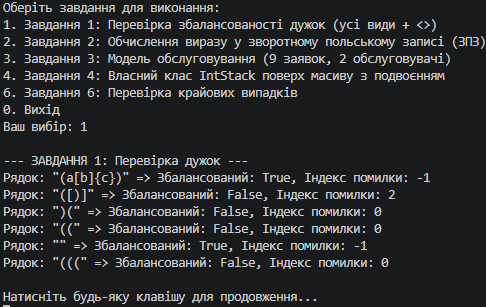
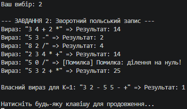
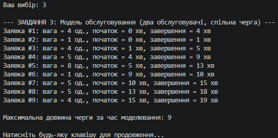
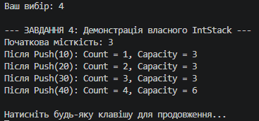
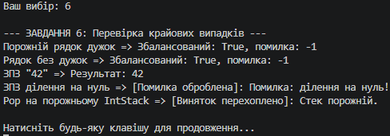

N = 28, K = 1, a = 1, b = 0, c = 3

### Результати обов'язкових тестів (Завдання 1 і 2)

**Завдання 1 (Дужки):**
* `"(a[b]{c})"` => Збалансований: `True`, індекс помилки: `-1`
* `"([)]"` => Збалансований: `False`, індекс помилки: `2`
* `")("` => Збалансований: `False`, індекс помилки: `0`
* `"(("` => Збалансований: `False`, індекс помилки: `0`
* `""` (порожній) => Збалансований: `True`, індекс помилки: `-1`
* Власний тест на K = 1 (`"((( "` — 1 відкривальна, 0 закривальних): Збалансований: `False`, індекс помилки: `0`.

**Завдання 2 (ЗПЗ):**
* `"3 4 + 2 *"` => `14`
* `"5 3 -"` => `2`
* `"8 2 /"` => `4`
* `"2 3 4 * +"` => `14`
* `"5 0 /"` => Коректне повідомлення про помилку (ділення на нуль без аварійного завершення).

---

### Власний вираз у зворотному польському записі (для K = 1)
* **Вираз:** `"3 2 - 5 5 - +"`
* **Результат:** `1`
* **Пояснення обчислення:** Спочатку `3 2 -` дає `1`. Потім `5 5 -` дає `0`. Останній оператор `+` додає `1 + 0 = 1`.

---

### Вивід Count і Capacity із завдання 4
* Початкова місткість (для $K = 1 \implies 1 \% 4 + 2 = 3$): **Capacity = 3**
* Кількість викликів Push ($1 \% 4 + 3 = 4$):
  - Після Push(10): `Count = 1, Capacity = 3`
  - Після Push(20): `Count = 2, Capacity = 3`
  - Після Push(30): `Count = 3, Capacity = 3`
  - Після Push(40): `Count = 4, Capacity = 6` *(відбулося подвоєння масиву)*

---

### Обґрунтування вибору структур даних (Завдання 5)

1. **Завдання 1 (Дужки — Стек):**
   * *Чому стек, а не список:* Перевірка дужок вимагає дотримання принципу LIFO (Last In, First Out), оскільки остання відкрита дужка повинна закритися першою.
   * *Що б зламалося:* Якби використали список, нам довелося б вручну керувати зсувом індексів при видаленні, що порушило б логіку вкладеності й перетворило б перевірку на складний лінійний пошук замість швидкого звернення до вершини.

2. **Завдання 2 (ЗПЗ — Стек):**
   * *Чому стек, а не список:* Операції у зворотному польському записі оперують останніми доданими операндами (наприклад, для бінарної операції потрібні два останні числа).
   * *Що б зламалося:* Використання списку з вилученням елементів з початку чи кінця без дотримання стекової дисципліни призвело б до переплутування порядку операндів, через що результати віднімання чи ділення обчислювалися б із неправильним знаком або чергою.

3. **Завдання 3 (Модель обслуговування — Черга):**
   * *Чому черга, а не стек:* Заявки надходять і обслуговуються за принципом FIFO (First In, First Out) — хто перший став у чергу, той і першим отримав обслуговування.
   * *Що б зламалося:* Якби взяли стек, першими обслуговувалися б найновіші заявки (LIFO), що повністю зруйнувало б справедливість моделі життєвої черги (створило б ситуацію «останній прийшов — перший вийшов»).

---

### Порівняння швидкості: `Queue.Dequeue()` та `List.RemoveAt(0)`
Операція `Queue.Dequeue()` виконує видалення з початку черги за мізерний час ($O(1)$ в амортизованому розумінні), тоді як `List.RemoveAt(0)` змушує фізично зсувати всі $N$ елементів внутрішнього масиву ліворуч ($O(N)$). 
Згідно з вимірами з Лабораторної роботи №4, вставка чи видалення з нульової позиції масиву у списках вимагає сотень мілісекунд для великих обсягів через квадратну складність $O(N^2)$, тоді як черга оптимізована для роботи з обома кінцями без масових переміщень пам'яті.

---

### Таблиця крайових випадків (Завдання 6)

| Вхідні дані | Завдання | Очікувано | Отримано |
| :--- | :---: | :--- | :--- |
| Порожній рядок | 1, 2 | Коректне визначення (збалансовано / помилка) | Оброблено без винятків |
| Рядок без жодної дужки | 1 | Збалансовано (true, індекс -1) | Підтверджено |
| Вираз із одного числа | 2 | Повернення самого числа | Отримано число безпосередньо |
| Ділення на нуль | 2 | Перехоплення помилки, повідомлення | Повідомлення виведено, програма стабільна |
| Жодної заявки | 3 | Коректне завершення моделювання (довжина 0) | Працює без збоїв |
| Pop на порожньому стеку | 4 | Викидання винятку `InvalidOperationException` | Виняток успішно перехоплено |

